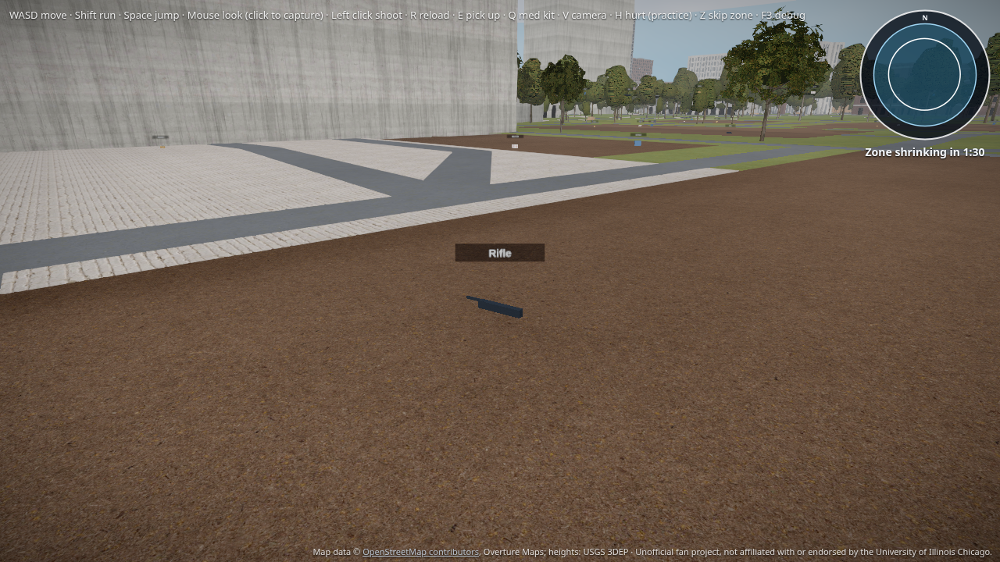
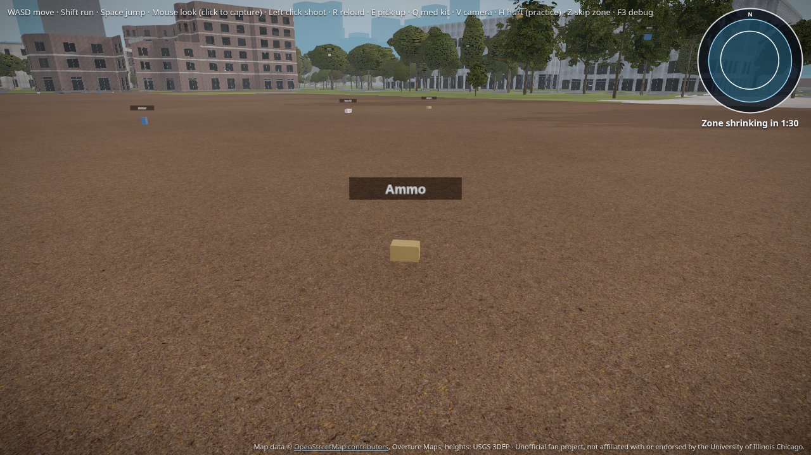

# B6: Building loot

Glb `loot_spawn_NN` markers from every non-farOnly building feed the existing combat loot crates. Each marker is Rapier-raycast to a floor within 0.5 m; bad markers are dropped with a console warning and listed in the test.

UH and Daley stay on their own landmark loot (farOnly strips glb markers).

## Screenshots

Lecture centers loot on the ground (Rifle crate + distant markers):

Student Center East apron loot (Ammo crate + Armor/Med kit farther out):

