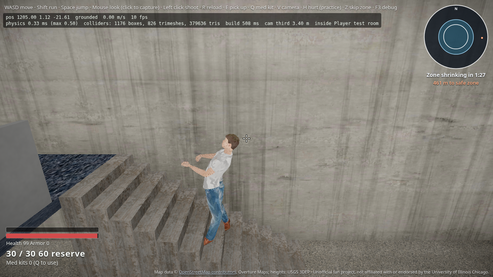
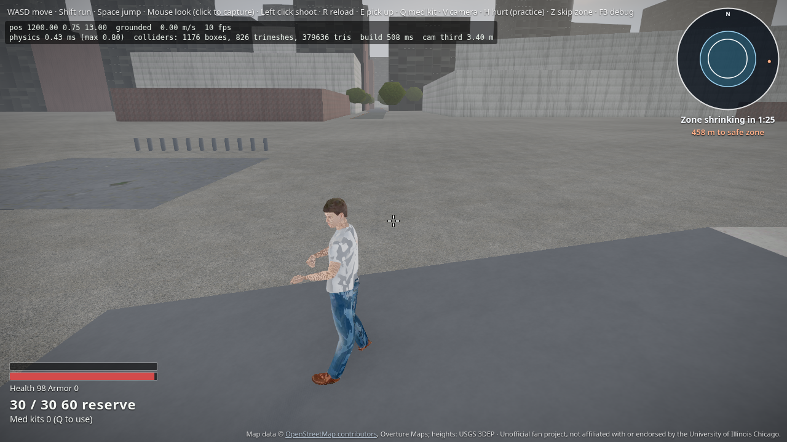
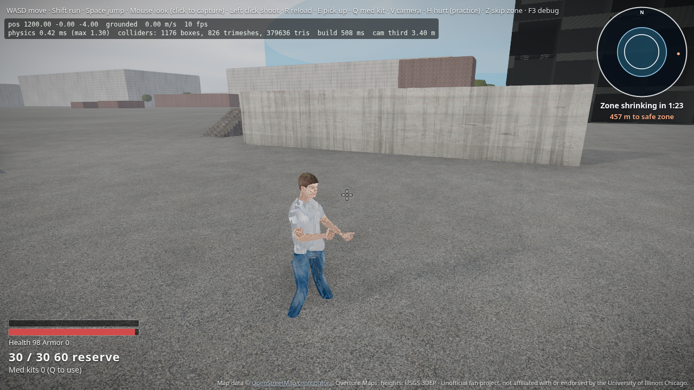

# Character realism polish

Foot IK so animated feet plant on stairs and slopes, plus a procedural hit flinch (no hit clip ships with the Mixamo set) and a local-player camera kick.

## Foot IK

Each foot raycasts down through Rapier (`GroundProbe`). A two-bone analytic IK bends the Mixamo leg chain onto the hit, and a smoothed pelvis offset drops or lifts the hips when both feet need ground below or above the authored pose. Airborne / death / jump skip the plant. The procedural fallback figure accepts `setGroundProbe` as a no-op so the same player path works without `anims.glb`.

## Hit reaction

There is no hit animation in `anims.glb`. Damage drives a short spine / Spine1 quaternion offset from `hitDir × up` (~0.28 s), and the local camera gets an additive yaw/pitch kick that eases out. Practice hurt (H) invents a hit from ahead of the camera so the lean reads clearly. Hitscan damage on dummies passes the shot direction.

## Key / URL self-check

Covered by `controls.selfCheck.test.ts`: missing / `?squad=solo` → solo; only `?squad=bots`; Q medkit, H hurt, P ping, K/J knock, F revive, L heal-all, O wipe, Z zone, arrows spectate; `?enemySquads`, `?bleedFast`, `?zoneFast`.
