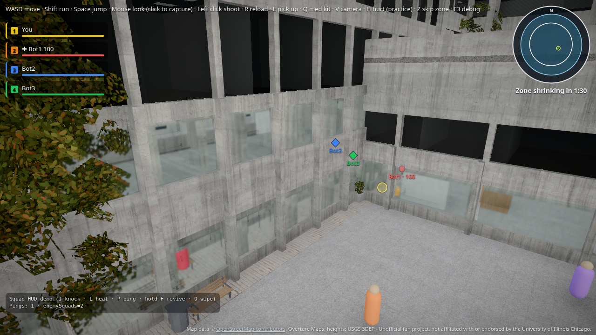
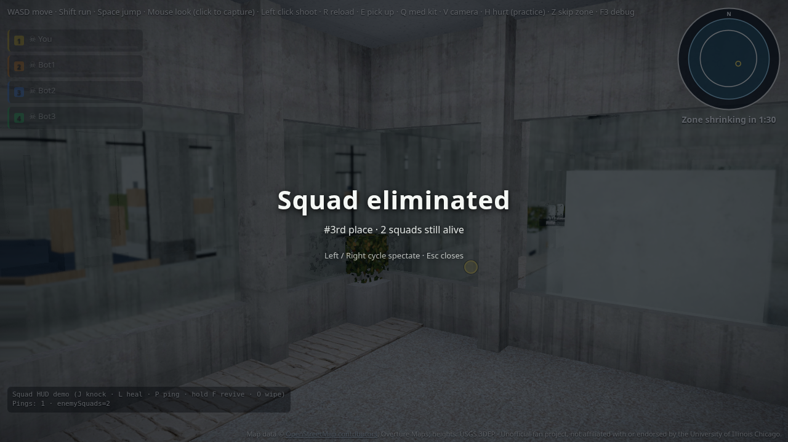

# S5: Enemy squads, placement, spectate

`?squad=bots&enemySquads=N` (0-4) adds enemy bot squads. When your squad is wiped you get a placement screen. After you die, Left/Right cycle living or downed teammates only. Debug: O wipes your squad.

## Screenshots

Enemy capsules in the courtyard with `enemySquads=2` and the team panel:

Placement overlay after a wipe (`#3rd place`):

