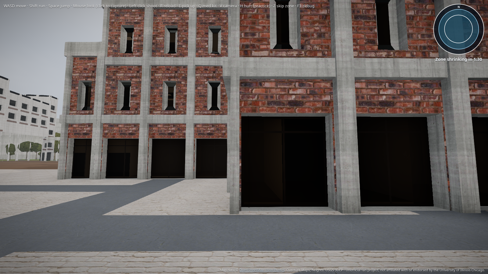
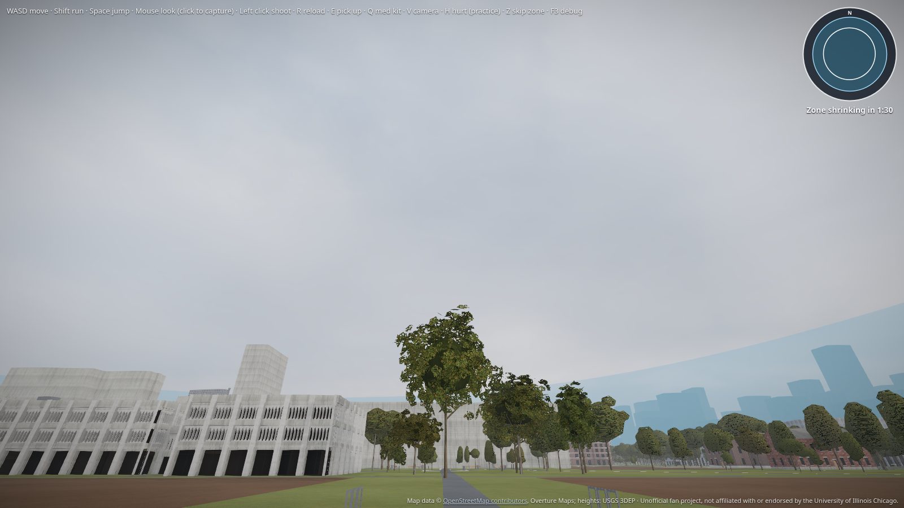

# SEL bridge supports (Rev 4)

Atlas rebuilt `sel-seo.glb` with end walls and a pier grid under the elevated SEL East–West connector (minHeight 12 m). Door count drops to 9 (was 11; bridge no longer gets ground doors) and loot to 12 (was 16). Wall boxes: 100.

## Screenshots

Plaza view of the elevated span:

From south of the span looking north-up at the soffit and pier grid:

## Checks

- `verify-glbs`: 9 doors, 0 images, meshopt + quantization, clean names
- Door walk-through + side-wall block + loot floors (vitest)
- Expected counts in `buildings.test.ts`: doors 9, loot 12
